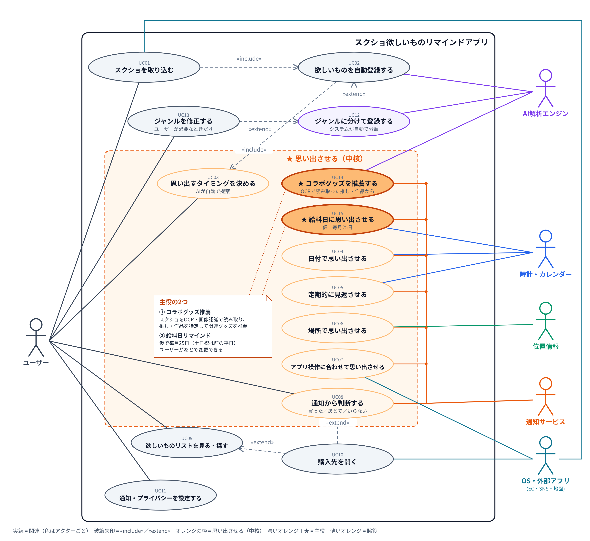

# スクショ欲しいものリマインドアプリ 要件定義まとめ（現時点）

- 作成日: 2026-11-13
- ステータス: **現時点のまとめ（中核の「思い出させる」部分は仮置き）**
- 詳細版: [screenshot-ai-app-requirements.md](screenshot-ai-app-requirements.md)
- ユースケース図: [usecase-diagram.png](usecase-diagram.png)

> **このまとめの読み方**
> - ✅ **確定（現時点）**: 内容が固まっている部分
> - 🚧 **仮置き**: アプリの中核である「思い出させる」部分。方向性だけ置いておき、**詳細は後で詰める**

---

## 1. 課題とコンセプト ✅

### 1.1 解決したい課題
SNSやネットで気になった商品を「後で買おう」とスクショしても、次のことが起きる。

| # | 課題 |
|---|---|
| ① | 保存したこと自体を忘れてしまう |
| ② | 写真が多すぎて見つからない |
| ③ | 買い物のときに、何が欲しかったのか思い出せない |
| ④ | 欲しいものリストに手で登録するのが面倒 |

→ **「欲しいと思った瞬間」と「実際に買い物をするタイミング」の間にある記憶の抜け落ち** を解決する。

### 1.2 コンセプト
> **「欲しいと思った瞬間を、買うべき瞬間に届ける」**
> スクショするだけで欲しいものが登録・ジャンル分けされ、アプリの方からちょうどいいタイミングで思い出させる。

### 1.3 スコープ
- 対象: Android スマートフォン（iOSは未決）
- 対象外: PC版、決済・アプリ内購入、価格比較サイトとの連携、他人との共有リスト

---

## 2. ペルソナ ✅

| | PA. 大学生（20歳・女性） | PB. 社会人5年目（27歳・男性） |
|---|---|---|
| 関心 | 映画、服、キャラクターのコラボグッズ、インテリア | 漫画、ガジェット、コーヒーグッズ、時計、服、ラーメン、アイドルグッズ |
| よく撮るもの | コーデ、コラボ商品一覧、イベント告知、おしゃれな部屋 | 新刊情報、商品ページ、行きたいラーメン屋、グッズの受注告知 |
| 困りごと | SNSごとに保存先がバラバラ／期間限定を逃す | 趣味の情報がごちゃ混ぜ／締切・発売日を逃す／店の近くで思い出せない |
| 懸念 | 無料で使いたい／DMのスクショは見られたくない | 仕事のスクショは除外したい／通知が多いのは嫌 |

---

## 3. ユースケース ✅（中核部分は 🚧）

| ID | ユースケース | 誰が | 状態 |
|---|---|---|---|
| UC01 | スクショを取り込む | ユーザー, OS | ✅ |
| UC02 | 欲しいものを自動登録する | AI | ✅ |
| UC12 | ジャンルに分けて登録する（UC02 の extend） | AI（システムが自動で分類） | ✅ |
| UC13 | ジャンルを修正する（UC12 の extend） | ユーザー（必要なときだけ） | ✅ |
| UC09 | 欲しいものリストを見る・探す | ユーザー | ✅ |
| UC10 | 購入先を開く | ユーザー, OS | ✅ |
| UC11 | 通知・プライバシーを設定する | ユーザー | ✅ |
| UC03 | 思い出すタイミングを決める | ユーザー, AI | 🚧 |
| UC14 | ★ コラボグッズを推薦する | AI, 通知 | 🚧 主役候補 |
| UC15 | ★ 給料日に思い出させる | 時計, 通知 | 🚧 主役候補 |
| UC04〜UC07 | 日付／定期／場所／アプリ操作で思い出させる | 時計・位置情報・OS, 通知 | 🚧 脇役候補 |
| UC08 | 通知から判断する（買った／あとで／いらない） | ユーザー | 🚧 |

---

## 4. 機能要件

優先度: **M**ust ／ **S**hould ／ **C**ould ／ **W**on't（今回はやらない）

### 4.1 取り込みと自動登録 ✅
| ID | 機能 | 内容 | 優先度 |
|---|---|---|---|
| F-01 | スクショの自動取り込み | スクショフォルダを監視し、撮影後に自動で取り込む | M |
| F-02 | SNSの共有メニューから取り込み | X・TikTok・Instagram などから画像とURLを受け取る | M |
| F-03 | 過去スクショの一括取り込み | 初回起動時に過去分から商品だけを登録 | S |
| F-04 | 商品の判定 | スクショが「欲しいもの」かどうかを判定 | M |
| F-05 | 商品情報の抽出（OCR） | 商品名・ブランド・価格・URL・販売店を読み取る | M |
| F-08 | 取り込まないアプリの設定 | LINE・銀行・仕事用アプリなどを除外 | M |

### 4.2 ジャンル分け ✅
| ID | 機能 | 内容 | 優先度 |
|---|---|---|---|
| F-06 | ジャンルの自動分類 | システムがコスメ／服／ガジェット／家具・雑貨／グッズ／漫画・本／飲食店 などに自動で分ける | M |
| F-09 | ジャンル・内容の修正 | 自動の結果が違うときだけユーザーが直す（商品でないものを外す、商品名を直す） | M |
| F-07 | 推し・作品・コラボ別まとめ | キャラクター・作品・アイドル・コラボ先でまとめる | C |

### 4.3 欲しいものリスト ✅
| ID | 機能 | 内容 | 優先度 |
|---|---|---|---|
| F-20 | 欲しいものリスト | カード形式の一覧。ジャンル別・登録順・期限順で表示 | M |
| F-21 | 詳細画面 | 元のスクショ、商品情報、メモ、購入先ボタン | M |
| F-22 | キーワード検索 | 商品名・読み取った文字・メモで検索 | S |
| F-24 | 購入先を開く | 元の投稿・ECページ・地図を開く | S |
| F-23 | 自然な言葉での検索 | 「先月見たちいかわのグッズ」のような検索 | C |
| F-25 | 漫画の巻数管理 | 持っている巻・欲しい巻を管理 | C |
| F-26 | インテリアの提案 | 部屋の写真から取り入れやすいアイテムを提案 | C |
| F-27 | 価格・再販・在庫の通知 | 外部データが必要 | W |

### 4.4 設定・プライバシー ✅
| ID | 機能 | 内容 | 優先度 |
|---|---|---|---|
| F-30 | オンボーディング | 写真・通知などの権限を理由とともに説明して許可をもらう | M |
| F-31 | AIのON/OFF | OFFのときは自動処理を止める | M |
| F-32 | 削除と全データ削除 | 個別削除、ゴミ箱、全削除 | M |
| F-33 | データのエクスポート | 欲しいものリストの書き出し | C |
| F-34 | クラウド同期・機種変更 | 複数端末で同期 | W |

### 4.5 思い出させる（中核）🚧 仮置き

> **ここはアプリの中核だが、詳細は後回し。** 現時点の方向性だけを置いておく。
> 下の内容は「候補」であり、ID・優先度・仕様は確定していない。

**方向性（現時点の合意）**
- **主役の2つ**
  - **コラボグッズ推薦**: スクショをOCR・画像認識で読み取って推し・作品を特定し、関連するコラボグッズを推薦して通知する
  - **給料日リマインド**: 給料日に欲しいものをまとめて通知する。給料日は **仮で毎月25日**（土日祝は直前の平日、ユーザーが変更可）
- **脇役の候補**: 期限・発売日での通知／週1回の見返し／お店の近くでの通知／ECアプリを開いたときの通知
- **共通の候補**: 通知から「買った／あとで／いらない」をワンタップ、通知の上限・通知しない時間帯

**後で決めること**
| # | 決めること |
|---|---|
| C-1 | 主役2つの具体的な仕様（推薦の出し方、通知の文面・件数・時刻） |
| C-2 | コラボグッズの情報をどこから取るか（スクショだけでは新しいコラボは分からない） |
| C-3 | 脇役のうち、どれをどの段階で入れるか |
| C-4 | 撮影直後にタイミングを聞くか、完全に自動で決めるか |
| C-5 | 通知の量の上限・既定の頻度 |
| C-6 | 給料日の初期値を25日のままにするか、最初の設定画面で聞くか |

---

## 5. 非機能要件 ✅（通知関連は 🚧）

| 分類 | 主な要件 |
|---|---|
| 性能 | 撮影から10秒以内（端末内）／30秒以内（クラウド）に解析完了。1,000件の一括取り込みを裏で処理 |
| 精度 | 商品の判定・ジャンル分類の精度を評価セットで計測し、モデル更新のたびに確認 |
| プライバシー | 原則として端末内で処理。クラウドに送る場合は同意をもらい、送るデータを最小限に。別目的に使わない。端末内のデータを暗号化 |
| 使いやすさ | 普段の利用で手入力が要らない。AIが作った内容だと分かり、すぐ直せる。ダークモード・文字サイズ・読み上げに対応 |
| 互換性 | Android 12 以上（暫定）。AIモデルを差し替えられる作り |
| コスト | クラウドAIを使う場合、1ユーザーあたりの月額コストの上限を決める（例: 50円以内） |
| 🚧 通知の信頼性 | 時刻どおりに届く、再起動後も消えない、電池を食いすぎない（中核の仕様が決まってから数値を決める） |

---

## 6. 優先順位とリリース計画（仮）

中核の仕様を詰めている間に、**中核を載せるための土台を先に作る** 進め方にする。

| 段階 | 目的 | 含めるもの | 状態 |
|---|---|---|---|
| **Step 1: 土台** | スクショするだけで登録・ジャンル分けされ、一覧で見られる | F-01, F-02, F-04, F-05, F-06, F-08, F-09, F-20, F-21, F-30〜F-32 | ✅ 着手できる |
| **Step 2: 中核（主役）** | コラボグッズ推薦と給料日リマインド | §4.5 の主役2つ ＋ 通知からの判断・通知量の制御 | 🚧 仕様を決めてから |
| **Step 3: 中核（脇役）** | 期限・定期・場所などで思い出させる | §4.5 の脇役候補 | 🚧 仕様を決めてから |
| **Step 4: 便利機能** | 検索・購入先・付加価値 | F-03, F-22, F-24 → F-07, F-23, F-25, F-26, F-33 | ✅ 内容は確定 |
| 将来検討 | — | F-27 価格・再販通知、F-34 クラウド同期、iOS版、PC版 | — |

---

## 7. 未決事項

| # | 論点 | 状態 |
|---|---|---|
| Q1 | 対象OS（Androidのみか、iOSもか） | 未決 |
| Q2 | AIの処理場所（端末内／クラウド／併用） | 未決（併用を推奨） |
| Q3 | OCR・画像認識に使うモデル | 未決（日本語の告知画像で精度比較が必要） |
| Q4 | 収益モデル（無料／買い切り／サブスク／アフィリエイト） | 未決 |
| Q5 | アプリ名（既存製品と混同しない独自の名前） | 未決 |
| C-1〜C-6 | 中核「思い出させる」の詳細（§4.5） | 🚧 後回し |
