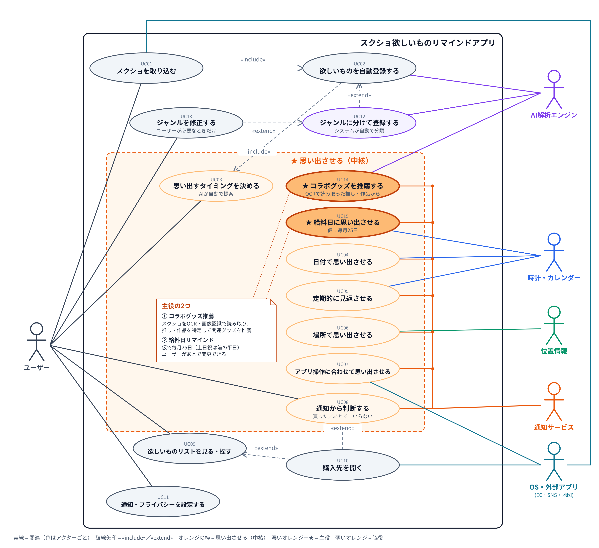
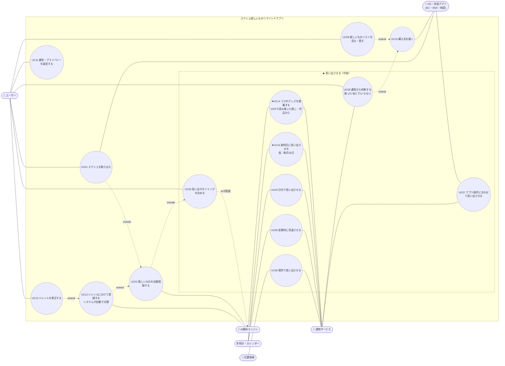
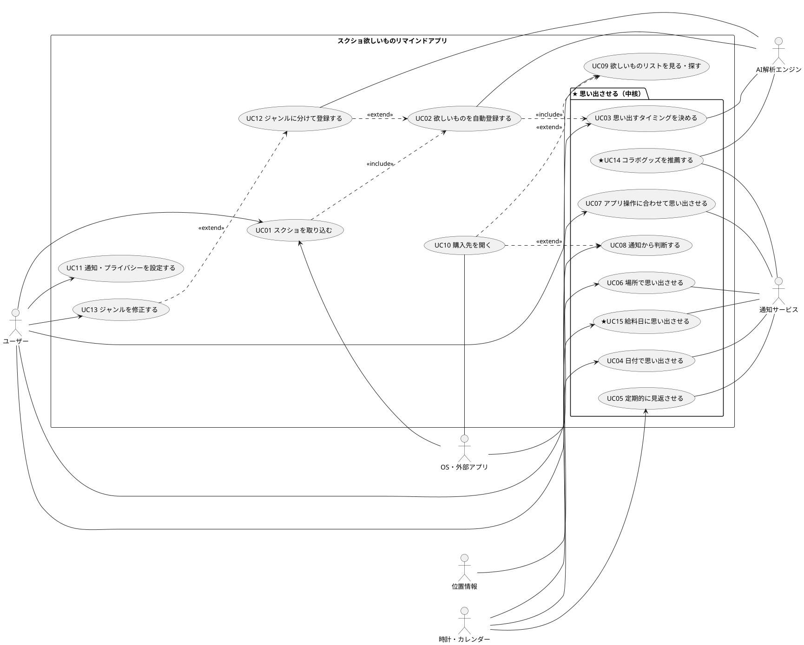

# スクショ欲しいものリマインドアプリ 要件定義（叩き台）

- 作成日: 2026-11-13
- ステータス: ドラフト v0.2（「買うタイミングで思い出させる」を軸に再構成）
- 参考: Google「Pixel スクリーンショット」の公開情報（機能コンセプトの参考のみ）

---

## 1. 概要

### 1.1 解決したい課題・背景

日常生活の中で、SNS やインターネットを見ていると、気になる商品を見つけることがあります。
例えば、

- TikTok で紹介されていたメイク用品
- Instagram で見つけたかわいい洋服
- YouTube で紹介されていた PC 周辺機器
- 友達が使っていて気になった商品
- ネットショッピングで見つけた家具や雑貨

こうした商品を「後で買おう」と思ってスクリーンショットしても、時間が経つと以下のような問題が発生します。

| # | 課題 | 内容 |
|---|---|---|
| ① | 保存したこと自体を忘れてしまう | スクリーンショットを撮っただけで満足してしまい、後から見返さない |
| ② | 写真が多すぎて見つからない | ギャラリーには日常の写真やスクリーンショットが大量にあり、欲しかった商品を探すのが大変 |
| ③ | 何が欲しかったのか思い出せない | 買い物に行ったときに「何か欲しかったものがあった気がするけど、なんだったっけ？」となってしまう |
| ④ | 既存の欲しいものリストに登録するのが面倒 | 商品を見つけるたびに、商品名や URL をコピーして、別のアプリに登録するのは手間がかかる |

このような **「欲しいと思った瞬間」と「実際に買い物をするタイミング」の間にある記憶の抜け落ち** を解決したいと考えています。

### 1.2 コンセプト

> **「欲しいと思った瞬間を、買うべき瞬間に届ける」**
> スクショするだけで欲しいものが登録され、**ユーザーが探しに来なくても、アプリの方から“ちょうどいいタイミング”で思い出させる。**

既存のメモやウィッシュリストのアプリは、**ユーザーが自分から見に行く**ことが前提です。そのため、そもそも忘れてしまう人（課題①③）は救えません。
このアプリは **「思い出させる（プッシュ）」を主役** にし、整理や検索はそれを支える脇役と位置づけます。

| 課題 | 本アプリでの解決 | 役割 |
|---|---|---|
| ① 保存を忘れる | アプリから定期的・期限前に思い出させる | **主役** |
| ③ 何が欲しかったか思い出せない | 店の近くに来たとき、ECアプリを開いたときなど、買い物の場面で思い出させる | **主役** |
| ④ 登録が面倒 | スクショするだけで自動登録（思い出させるための前提） | 前提 |
| ② 見つからない | 欲しいものリストと検索で探せる | 脇役 |

### 1.3 「思い出させるタイミング」の設計（本アプリの中核）

#### 主役の2つ（最優先・Must）

| 主役 | 内容 | 優先度 |
|---|---|---|
| **★ コラボグッズ推薦** | スクショを **OCR・画像認識で読み取り**、写っているキャラクター・作品・アイドル・コラボ先（推し）を特定する。その推しの **新しいコラボグッズや関連グッズを推薦して通知** する（例: 「ちいかわの新しいコラボが発表されました」「前に保存した○○コラボの第2弾が明日から」） | **Must（主役）** |
| **★ 給料日リマインド** | 給料日に「欲しいもの」をまとめて通知する。**給料日は仮で毎月25日**（土日祝の場合は直前の平日）に設定しておき、ユーザーが後から変更できる。価格の高い物や「あとで」にした物を優先して出す | **Must（主役）** |

#### 脇役のタイミング（主役を補う）

| 種類 | タイミングの例 | 対応する課題 | 優先度 |
|---|---|---|---|
| **T0 撮影直後** | スクショした直後に「いつ思い出したい？」を提案（例: 給料日／週末／期限の3日前／お店の近く）。ワンタップで設定 | ①④ | Must |
| **T1 期限・日付** | 期間限定の終了前、受注締切前、発売日・公開日、セール開始日 | ① | Must |
| **T2 定期の見返し** | 週末や月初に「今週の欲しいもの」をまとめて通知し、まだ欲しいか確認する | ① | Must |
| **T3 場所** | 欲しいものを扱う店や商業施設の近くに来たとき（ドラッグストア、ユニクロ、家電量販店など） | ③ | Should |
| **T4 行動** | ECアプリや買い物アプリを開いたとき、似た商品を再びスクショしたとき | ③ | Should |
| **T5 お金の都合** | ポイント還元デー、大型セール（ブラックフライデーなど）。※給料日は主役に格上げ | ①③ | Should |
| **T6 状況・季節** | 季節の変わり目（冬服）、旅行や誕生日などのイベント前 | ③ | Could |
| **T7 学習による最適化** | 通知を開いた・無視した履歴から、その人に合う曜日・時間帯・頻度を学習する | 全体 | Could |

**設計の原則**
- **通知しすぎない**: 1日の上限、まとめて送る、通知しない時間帯を設ける。通知が多すぎるとオフにされ、アプリの価値がなくなる
- **通知から1タップで判断できる**: 「買った」「まだ欲しい（あとで）」「もういらない」をその場で選べる
- **リストを常に新鮮に保つ**: 「いらない」「買った」がたまっていくことで、本当に欲しいものだけが残る

### 1.4 スコープ（MVP時点）
- 対象: Android スマートフォン（iOS対応は未決、§8参照）
- 対象外: PC版、決済やアプリ内購入、価格比較サイトとの連携、他人との共有リスト

---

## 2. 想定ユーザー（ペルソナ）

> ※架空の人物です。

### PA. 小林 あかり（20歳・大学2年・女性）— 「推しと“欲しい”を全部スクショする派」
| 項目 | 内容 |
|---|---|
| 趣味・関心 | 映画、服、キャラクターグッズ（ちいかわ等のコラボ商品）、インテリア |
| SNS利用 | X（Twitter）でスクショ・ブックマーク、TikTok・Instagramでも保存 → **保存先がアプリごとにバラバラ** |
| よく撮るもの | 服のコーデ、コラボ商品一覧・欲しいグッズ、コラボカフェやイベントの告知、「いいな」と思った部屋の写真、気になる映画 |
| 課題 | ①期間限定のコラボやイベントを撮ったのに、**気づいたら終わっている** ②SNSごとに保存がバラバラで、どこに保存したか分からない ③おしゃれな部屋を撮りためても、自分の部屋は一向にそうならない |
| **思い出してほしいタイミング** | ・コラボやイベントが **始まる日と、終わる数日前** ・**グッズの販売開始日** ・**仕送りやバイト代が入った日** ・**ショッピングモールや雑貨屋の近く**にいるとき（インテリア・服） ・**映画の公開日・配信開始日** |
| 利用頻度 | 毎日（1日5〜10枚撮影） |
| 懸念 | 無料で使いたい／DMや友達とのやり取りのスクショは見られたくない |

### PB. 伊藤 大輔（27歳・社会人5年目・男性）— 「多趣味コレクター」
| 項目 | 内容 |
|---|---|
| 趣味・関心 | 単行本の漫画、ガジェット、コーヒーグッズ、時計、服、ラーメン、アイドルグッズ |
| よく撮るもの | 漫画の新刊情報・表紙、ガジェットや時計の商品ページ、コーヒー器具、行きたいラーメン屋、アイドルグッズの受注・発売告知 |
| 課題 | ①アイドルグッズの **受注締切や発売日を逃す** ②行きたいラーメン屋を撮っても、**近くに来たときに思い出せない** ③漫画の何巻まで持っているか分からず、二重買いや買い逃しが起きる ④高い物（時計・ガジェット）は迷っているうちに忘れる |
| **思い出してほしいタイミング** | ・**受注締切の前日**と**発売日** ・**ラーメン屋の近く**にいるとき（昼どき・夜） ・**本屋や家電量販店の近く**にいるとき ・**給料日やボーナス時期**（時計・ガジェット） ・**大型セールの前**（Amazonのセールなど） |
| 利用頻度 | 週数回（通知をきっかけに開く） |
| 懸念 | 仕事関係のスクショ（社内資料など）が混ざるので除外したい／通知が多すぎるのは嫌 |

### 2人に共通するニーズ（要件への示唆）
1. **日付で思い出したい**: 期限・締切・発売日 → T1 は Must
2. **場所で思い出したい**: 店の近く → T3 は Should の中でも最優先
3. **お金が入ったときに思い出したい**: 給料日・仕送り日 → T5 を T0 の選択肢に入れる
4. **通知は欲しいが、多すぎるのは困る**: 通知の上限・まとめ送りは Must
5. **見られたくないスクショの除外**: DM・仕事資料 → 除外設定は Must

その他の候補（初期案・参考）

| ID | ペルソナ | 思い出してほしいタイミング | 示唆 |
|---|---|---|---|
| P1 | 28歳・会社員（SNSで見たカフェ・コスメをスクショ） | 週末の予定を立てるとき、渋谷など特定の街にいるとき | 場所トリガーの需要 |
| P2 | 41歳・2児の父（予約・チケット管理） | 予約日の前日 | 日付トリガー。欲しいもの以外への拡張の候補 |
| P3 | 35歳・主婦（クーポン・お得情報） | クーポン期限前、スーパーやドラッグストアの近く | 期限＋場所の組み合わせ |
| P6 | 67歳・シニア | 分かりやすい通知文、少ない通知 | 通知UXの下限 |

---

## 3. ユースケース図

> 画像版: `usecase-diagram.png` ／ `usecase-diagram.svg`。以下は同じ内容のテキスト版です。

PlantUML版（正式なユースケース図記法）

---

## 4. ユースケース一覧

| ID | ユースケース | アクター | 概要 |
|---|---|---|---|
| UC01 | スクショを取り込む | ユーザー, OS・外部アプリ | 新しいスクショの自動検知、SNSの共有メニューからの受け取り、過去分の一括取り込み |
| UC02 | 欲しいものを自動登録する | AI | 商品かどうかを判定し、商品名・ブランド・価格・URL・期限を抽出して欲しいものリストに登録 |
| ★UC03 | 思い出すタイミングを決める | ユーザー, AI | 撮影直後にAIがタイミングを提案（期限前・給料日・店の近くなど）。ユーザーはワンタップで選ぶか変更する |
| ★★UC14 | コラボグッズを推薦する（主役） | AI, 通知 | OCR・画像認識でスクショから推し・作品・コラボ先を特定し、関連する新しいコラボグッズを推薦して通知する |
| ★★UC15 | 給料日に思い出させる（主役） | 時計, 通知 | 給料日（仮：毎月25日、土日祝は直前の平日。変更可）に欲しいものをまとめて通知する |
| ★UC04 | 日付で思い出させる | 時計, 通知 | 期限・締切・発売日・給料日・セール日になったら通知する |
| ★UC05 | 定期的に見返させる | 時計, 通知 | 週末や月初に、しばらく見ていない欲しいものをまとめて通知する |
| ★UC06 | 場所で思い出させる | 位置情報, 通知 | 欲しいものを扱う店や施設の近くに来たら通知する |
| ★UC07 | アプリ操作に合わせて思い出させる | OS・外部アプリ, 通知 | ECアプリを開いたときや、似た商品を再びスクショしたときに思い出させる |
| ★UC08 | 通知から判断する | ユーザー | 通知上で「買った」「あとで（再通知）」「もういらない」を選ぶ |
| UC09 | 欲しいものリストを見る・探す | ユーザー | カテゴリ・期限順の一覧、キーワード・自然な言葉での検索 |
| UC10 | 購入先を開く | ユーザー, OS・外部アプリ | 元の投稿・ECページ・地図を開く |
| UC12 | ジャンルに分けて登録する | AI（システム） | 登録時に、システムがカテゴリ（コスメ／服／ガジェット／家具・雑貨／グッズ 等）を自動で判定してジャンル別に登録する（UC02 の extend） |
| UC13 | ジャンルを修正する | ユーザー | 自動で分けたジャンルが違うときだけ、ユーザーが直す（UC12 の extend） |
| UC11 | 通知・プライバシーを設定する | ユーザー | 通知の頻度・時間帯、位置情報のON/OFF、取り込まないアプリ、AIのON/OFF |

---

## 5. 機能要件

優先度は MoSCoW（**M**ust ／ **S**hould ／ **C**ould ／ **W**on't＝今回はやらない）。
**★の付いた節がアプリの中核** で、**★★ は主役** です。

### ★★5.0 主役の思い出させ機能
| ID | 機能 | 説明 | 優先度 |
|---|---|---|---|
| R-70 | 推し・作品・コラボ先の特定 | スクショを OCR・画像認識で読み取り、キャラクター名・作品名・アイドル名・コラボ先・ブランドを特定して「推し」として記録 | M |
| R-71 | コラボグッズの推薦 | 推しに関連する新しいコラボグッズ・関連グッズを推薦する（情報源は §9 Q9 で要検討） | M |
| R-72 | コラボ推薦の通知 | 新しいコラボの発表・発売開始・受注締切のタイミングで通知。保存済みのコラボの「第2弾」「再販」も知らせる | M |
| R-73 | 推薦の振り分け | 推薦に「欲しい（リストに追加）」「興味なし」で応え、推しの精度を上げる | M |
| R-74 | 給料日の仮設定 | 初期値として **毎月25日** を設定（土日祝は直前の平日）。オンボーディングや設定で変更可能 | M |
| R-75 | 給料日のまとめ通知 | 給料日の朝に、欲しいものをまとめて通知。価格の高い物・「あとで」にした物・期限が近い物を優先して最大5件 | M |
| R-76 | 給料日前の予告 | 給料日の数日前に「25日に買うものリスト」を予告（任意） | S |

### ★5.1 タイミング設定（UC03）
| ID | 機能 | 説明 | 優先度 |
|---|---|---|---|
| R-01 | 撮影直後のタイミング提案 | 商品のスクショを検知したら通知かポップアップで「いつ思い出したい？」と聞き、AIが候補を3つほど出す（例: 期限の3日前／次の給料日／今週末） | M |
| R-02 | ワンタップ設定 | 候補をタップするだけで設定完了。何も選ばなければ既定のタイミング（定期見返し）にする | M |
| R-03 | タイミングの手動変更 | 日時指定、「1週間後」などの相対指定、繰り返しの有無 | M |
| R-04 | 複数タイミングの組み合わせ | 例: 「販売開始日」と「終了3日前」の両方で通知 | S |
| R-05 | ユーザー固有の日付登録 | 仕送り日・ポイントデーなどを登録し、タイミングの候補に使う（給料日は R-74 で仮設定済み） | S |

### ★5.2 日付トリガー（UC04）
| ID | 機能 | 説明 | 優先度 |
|---|---|---|---|
| R-10 | 期限・日付の自動抽出 | 期間限定の開始・終了、受注締切、発売日、公開日、クーポン期限をスクショから抽出 | M |
| R-11 | 期限前の通知 | 終了・締切の◯日前と当日に通知（既定は3日前と前日、変更可） | M |
| R-12 | 開始日の通知 | 販売開始・イベント開始・公開日に通知 | M |
| R-13 | セール日の通知 | R-05 の日付や大型セールの日に、その日に買う候補をまとめて通知（給料日は R-75） | S |
| R-14 | 「今が旬」ビュー | 開催中／もうすぐ終わる／もうすぐ始まるものを集めた画面。終わったものは自動で下へ | S |

### ★5.3 定期の見返し（UC05）
| ID | 機能 | 説明 | 優先度 |
|---|---|---|---|
| R-20 | 定期のまとめ通知 | 週1回（曜日と時刻は変更可）、まだ判断していない欲しいものを最大5件まとめて通知 | M |
| R-21 | 「まだ欲しい？」チェック | 一定期間（例: 2週間）見ていないものについて、まだ欲しいかを聞く | M |
| R-22 | スワイプで振り分け | 見返し画面で、カードを左右にスワイプして「残す／いらない」を素早く選ぶ | S |

### ★5.4 場所トリガー（UC06）
| ID | 機能 | 説明 | 優先度 |
|---|---|---|---|
| R-30 | 店のジャンルの推定 | 商品から「どこで買えるか」を推定する（例: コスメ→ドラッグストア、漫画→本屋、ガジェット→家電量販店） | S |
| R-31 | 店の近くで通知 | 推定したジャンルの店や、ユーザーが登録した店の近くに来たら通知（ジオフェンス） | S |
| R-32 | 飲食店の位置で通知 | ラーメン屋などスクショから住所が分かる店の近くに来たら通知。食事どきを優先 | S |
| R-33 | 「いまここで買えるもの」一覧 | 現在地の周辺で買えそうな欲しいものを一覧表示 | C |

### ★5.5 アプリ操作トリガー（UC07）
| ID | 機能 | 説明 | 優先度 |
|---|---|---|---|
| R-40 | 重複スクショの検知 | 同じ商品・似た商品を再びスクショしたら「前にも保存してるよ」と知らせ、欲しい度を上げる | S |
| R-41 | ホーム画面ウィジェット | 期限が近いものや今週の欲しいものを表示（ECアプリの横に置ける） | S |
| R-42 | ECアプリを開いたときに通知 | 指定したECアプリを開いたときに、関連する欲しいものを通知（OSの制約を要調査） | C |

### ★5.6 通知からの判断（UC08）
| ID | 機能 | 説明 | 優先度 |
|---|---|---|---|
| R-50 | 通知の操作ボタン | 通知上で「買った」「あとで」「いらない」を選べる | M |
| R-51 | 「あとで」の再通知 | あとでを選んだら、次のタイミング（翌日・週末・次の給料日など）を選べる | M |
| R-52 | 通知から詳細へ | 通知をタップすると、該当スクショと購入先のボタンがある詳細画面を開く | M |
| R-53 | 判断履歴 | 買った・いらないにしたものの履歴と、「買ってよかった」の振り返り | C |

### ★5.7 通知の量の制御（全トリガー共通）
| ID | 機能 | 説明 | 優先度 |
|---|---|---|---|
| R-60 | 通知の上限 | 1日あたりの通知数の上限（既定3件）。超える分はまとめ通知に回す | M |
| R-61 | 通知しない時間帯 | 夜間など、通知しない時間帯を設定 | M |
| R-62 | トリガーごとのON/OFF | 日付・定期・場所・アプリ操作を個別にON/OFF | M |
| R-63 | 最適なタイミングの学習 | 通知を開いた・無視した履歴から、曜日・時間帯・頻度を調整 | C |

### 5.8 取り込みと自動登録（UC01, UC02）
| ID | 機能 | 説明 | 優先度 |
|---|---|---|---|
| F-01 | 新規スクショの自動取り込み | スクショフォルダを監視し、撮影後に自動で取り込む | M |
| F-02 | SNSの共有メニューから取り込み | X・TikTok・Instagram などの「共有」から画像とURLを受け取る。元の投稿へのリンクも保存 | M |
| F-03 | 過去スクショの一括取り込み | 初回起動時に、過去のスクショから商品だけを抽出して登録（バックグラウンド） | S |
| F-04 | 商品の判定 | スクショが「欲しいもの」かどうかを判定。商品でなければリストに入れない | M |
| F-05 | 商品情報の抽出 | 文字認識（日英）で、商品名・ブランド・価格・URL・販売店を抽出 | M |
| F-06 | カテゴリ分類 | コスメ／服／ガジェット／家具・雑貨／グッズ／漫画・本／飲食店 など | M |
| F-07 | 推し・作品・コラボ別まとめ | キャラクター名・作品名・アイドル名・コラボ先で自動でまとめる | C |
| F-08 | 取り込まないアプリの設定 | LINE・銀行・仕事用アプリなどのスクショを取り込まない | M |
| F-09 | 誤判定の修正 | 商品でないものを外す、商品名・期限を手で直す | M |

### 5.9 欲しいものリストと検索（UC09, UC10）
| ID | 機能 | 説明 | 優先度 |
|---|---|---|---|
| F-20 | 欲しいものリスト | カード形式の一覧。並び順は「期限が近い順」を既定に、登録順・カテゴリ別も選べる | M |
| F-21 | 詳細画面 | 元のスクショ、商品情報、設定したタイミング、メモ、購入先ボタン | M |
| F-22 | キーワード検索 | 商品名・抽出した文字・メモで検索 | S |
| F-23 | 自然な言葉での検索 | 「先月見たちいかわのグッズ」のような検索 | C |
| F-24 | 購入先を開く | 元の投稿・ECページ・地図アプリを開く | S |
| F-25 | 漫画の巻数管理 | 持っている巻・欲しい巻を管理し、新刊の発売日を通知 | C |
| F-26 | インテリアの提案 | 部屋の写真からスタイルを解析し、取り入れやすいアイテムを提案 | C |
| F-27 | 価格・再販・在庫の通知 | 値下げや再販を通知 | W（外部データが必要なため将来） |

### 5.10 設定・プライバシー（UC11）
| ID | 機能 | 説明 | 優先度 |
|---|---|---|---|
| F-30 | オンボーディング | 写真・通知・位置情報の権限を、なぜ必要かを説明しながら許可してもらう。位置情報は後から許可でもよい | M |
| F-31 | AIのON/OFF | OFFのときはAI解析・自動登録を止める（手動登録は可能） | M |
| F-32 | 削除と全データ削除 | 個別削除、ゴミ箱、全データの削除 | M |
| F-33 | データのエクスポート | 欲しいものリストのエクスポート | C |
| F-34 | クラウド同期・機種変更 | 複数の端末で同期、バックアップ | W（将来） |

---

## 6. 非機能要件

### 6.1 通知の信頼性（★中核を支える要件）
| ID | 要件 | 目標値（暫定） |
|---|---|---|
| N-01 | 日付通知の正確さ | 指定時刻から±5分以内に届く（端末の省電力機能を考慮した実装） |
| N-02 | 再起動・アプリ更新後の維持 | 端末の再起動やアプリの更新後も、予約した通知が失われない |
| N-03 | 場所通知の精度 | 店から半径200m程度で反応。誤って届く割合を計測して調整 |
| N-04 | 位置情報による電池消費 | OSのジオフェンス機能を使い、常時GPSは使わない。1日の電池消費増は2%以内を目標 |
| N-05 | 撮影直後の提案の速さ | スクショから5秒以内に「いつ思い出したい？」を出す（遅いと撮影の流れが途切れる） |

### 6.2 性能
| ID | 要件 | 目標値（暫定） |
|---|---|---|
| N-10 | 解析完了までの時間 | 撮影から10秒以内（端末内）／30秒以内（クラウド） |
| N-11 | 一覧表示 | 1,000件でも滑らかにスクロール |
| N-12 | 一括取り込み | 1,000件をバックグラウンドで処理し、操作を妨げない |

### 6.3 プライバシー・セキュリティ
| ID | 要件 |
|---|---|
| N-20 | 原則として端末内で処理。クラウドで処理する場合は明示的に同意をもらい、送るデータを最小限にする |
| N-21 | **位置情報は端末内だけで使い、サーバーに送らない・保存しない** |
| N-22 | クラウドに送ったデータを学習など別の目的に使わない |
| N-23 | 端末内のデータを暗号化。生体認証でのアプリロックを選べる |
| N-24 | 個人情報保護法と、各ストアのデータ安全性ポリシーに準拠する |

### 6.4 ユーザビリティ
| ID | 要件 |
|---|---|
| N-30 | 通知の文は一目で分かる内容にする（例: 「ちいかわコラボ、あと3日で終了」） |
| N-31 | 通知から判断（買った・あとで・いらない）まで1タップ |
| N-32 | タイミング設定は撮影後、ワンタップで完了する |
| N-33 | AIが作った内容であることを表示し、間違いを直せるようにする |
| N-34 | ダークモード、文字サイズの変更、読み上げ機能に対応 |

### 6.5 互換性・保守性・コスト
| ID | 要件 |
|---|---|
| N-40 | 対応OS: Android 12 以上（暫定） |
| N-41 | AIモデルを差し替えられる作りにする |
| N-42 | 通知の開封率など、想起に関する指標を計測できる仕組み（§7）を入れる |
| N-43 | クラウドAIを使う場合、1ユーザーあたりの月額コストの上限を決める（例: 50円以内） |

---

## 7. 成功指標（KPI）

「思い出させる」ことが価値なので、**検索の回数ではなく、通知がきっかけで行動したか** を測ります。

| 指標 | 定義 | 目標（仮） |
|---|---|---|
| 通知の開封率 | 送った通知のうち開かれた割合 | 30%以上 |
| 判断率 | 通知を受けたもののうち「買った／いらない」を決めた割合 | 40%以上 |
| 期限内の判断率 | 期限付きのもので、期限前に判断された割合 | 70%以上 |
| 通知OFF率 | 通知をOFFにしたユーザーの割合（通知が多すぎるサイン） | 10%未満 |
| 継続率 | 4週目もアプリを使っているユーザーの割合 | 40%以上 |

---

## 8. 優先順位とリリース計画

### 8.1 優先順位の考え方
1. **「思い出させる」がアプリの価値そのもの**: 通知が届かなければ、ただの画像フォルダと同じ。最初から入れる
   - 中でも **コラボグッズ推薦** と **給料日リマインド（仮：毎月25日）** を主役として最優先で作る
2. **登録の自動化は、思い出させるための前提**: 登録が手間だと思い出させる対象がたまらないので、同時に作る
3. **日付 → 場所 → 行動 の順に作る**: 日付は実装しやすく効果も分かりやすい。場所は権限・電池・精度の課題があるので2番目
4. **通知しすぎ対策は初日から**: 一度通知をOFFにされると取り戻せない
5. **検索・整理は後回し**: 思い出させる仕組みがあれば、探す場面そのものが減る

### 8.2 フェーズ分け

| フェーズ | 目的 | 含める機能 |
|---|---|---|
| **Phase 1: MVP**（Must） | 「スクショしたものを、期限前と定期的に思い出させる」が成り立つかを検証（課題①④） | 取り込み F-01, F-02, F-04〜F-06, F-08, F-09 ／ **★★主役 R-70〜R-75** ／ **タイミング R-01〜R-03** ／ **日付 R-10〜R-12** ／ **定期見返し R-20, R-21** ／ **通知からの判断 R-50〜R-52** ／ **通知の量 R-60〜R-62** ／ リスト F-20, F-21 ／ 設定 F-30〜F-32 ／ N-01, N-02, N-05, N-20 |
| **Phase 2: 買い物の場面で思い出させる**（Should） | 「お店で思い出す」の実現（課題③） | **場所 R-30〜R-32** ／ **お金の都合 R-05, R-13, R-76** ／ R-04, R-14, R-22 ／ **アプリ操作 R-40, R-41** ／ F-03, F-22, F-24 ／ N-03, N-04, N-21 |
| **Phase 3: その人に合わせる**（Could） | 通知の精度を上げて差別化 | R-33, R-42, R-53, **R-63 学習** ／ F-07, F-23, F-25, F-26, F-33 ／ 季節・イベント（T6） |
| **将来検討**（Won't now） | — | F-27 価格・再販通知、F-34 クラウド同期、iOS版、PC版 |

### 8.3 実装順の目安（トップ12）
1. F-01, F-02 スクショ・SNS共有からの取り込み
2. F-04, F-05, F-06 商品の判定と情報抽出
3. F-20, F-21 欲しいものリストと詳細画面（最小限）
4. **★★ R-70〜R-73 推しの特定とコラボグッズ推薦**
5. **★★ R-74, R-75 給料日（仮：毎月25日）のまとめ通知**
6. **R-10 期限・日付の抽出**
7. **R-01, R-02, R-03 撮影直後のタイミング提案とワンタップ設定**
8. **R-11, R-12 日付の通知**（N-01, N-02 の信頼性を含む）
9. **R-50, R-51, R-52 通知から「買った・あとで・いらない」**
10. **R-20, R-21 週1回のまとめ通知と「まだ欲しい？」**
11. **R-60〜R-62 通知の上限・時間帯・ON/OFF**
12. F-08, F-30〜F-32 プライバシーとオンボーディング → 次は Phase 2 の **R-31 店の近くで通知**

---

## 9. 未決事項・要確認

| # | 論点 | 選択肢 | メモ |
|---|---|---|---|
| Q1 | 対象OS | Androidのみ／iOSも | iOSはスクショの自動検知に制約がある（共有メニュー経由が中心）。位置通知はiOSでも可能 |
| Q2 | AIの処理場所 | 端末内／クラウド／併用 | タイミング提案は5秒以内に出したいので、端末内の簡易判定とクラウドの詳細解析の併用を推奨 |
| Q3 | 店の位置データ | 地図APIを使う／ユーザー登録のみ | 「ドラッグストアの近く」を判定するには店舗データが必要。コストと利用規約を確認 |
| Q4 | 位置情報の権限 | 常に許可／使用中のみ | 店の近くでの通知には「常に許可」が必要。ストア審査と説明文の準備が要る |
| Q5 | 既定の通知頻度 | 週1回／週2回／毎日 | ユーザーテストで決める。初期は控えめ（週1回＋期限）を推奨 |
| Q6 | 大型セールの日付 | 手動で管理／外部データ | 運営側で年間カレンダーを用意するか |
| Q7 | 収益モデル | 無料／買い切り／サブスク | 購入先リンクのアフィリエイトも候補（ただし信頼性とのバランス） |
| Q8 | アプリ名 | — | 既存の製品名・ロゴと混同しない独自の名前にする |
| Q9 | コラボグッズ情報の入手先 | ユーザーのスクショのみ／公式サイト・ニュースの収集／外部API | スクショだけでは「新しいコラボ」は分からないため、外部の情報源が必要。各サイトの利用規約・著作権を確認 |
| Q10 | 給料日の初期値 | 毎月25日（仮決定） | 学生の仕送り日・バイト代の日など、ペルソナによって違う。オンボーディングで聞くか検討 |
